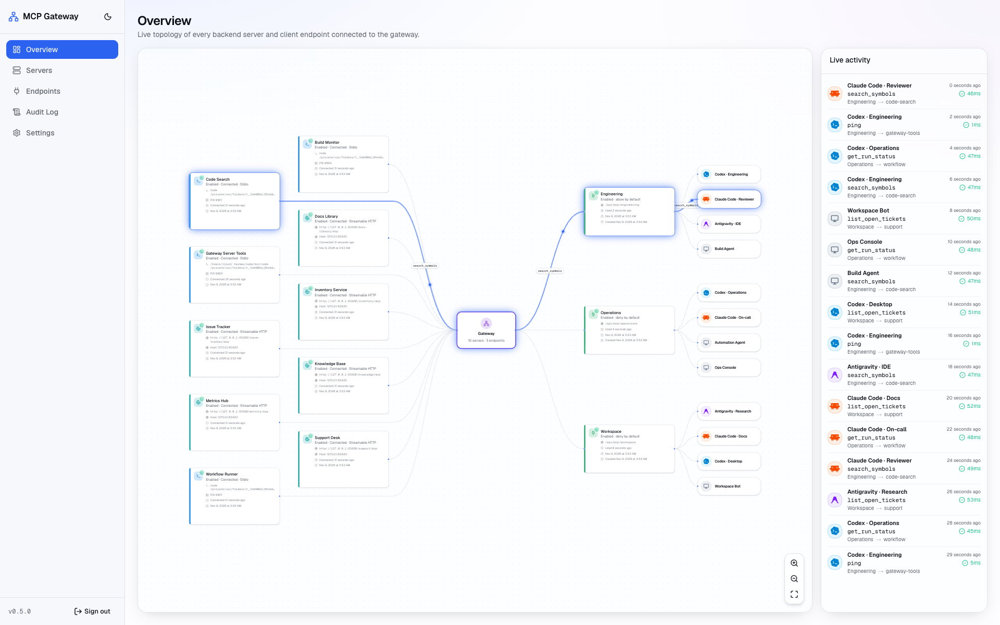
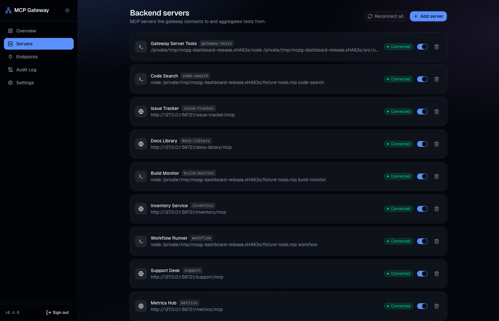
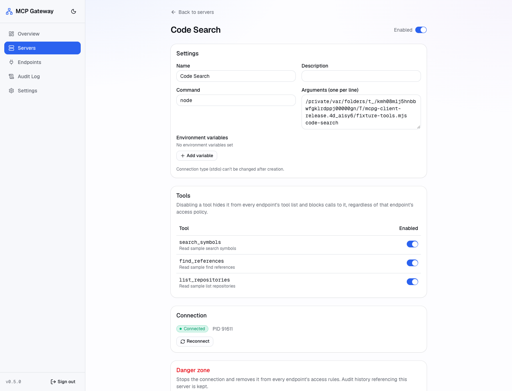
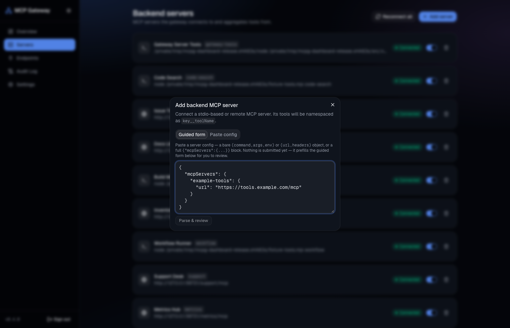
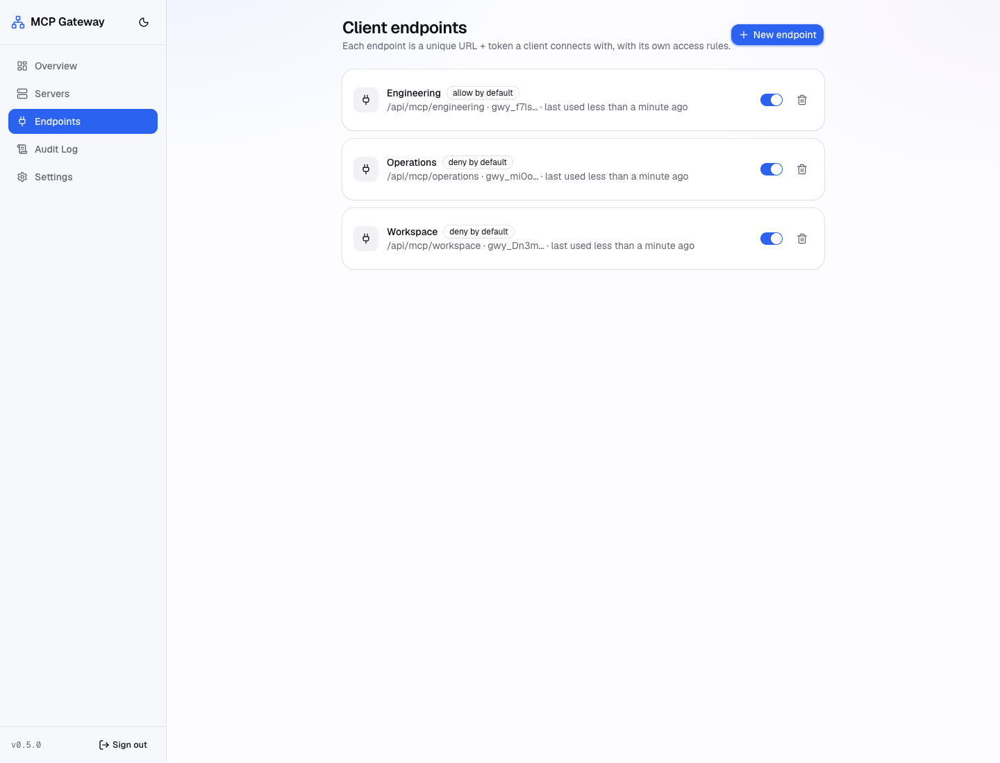
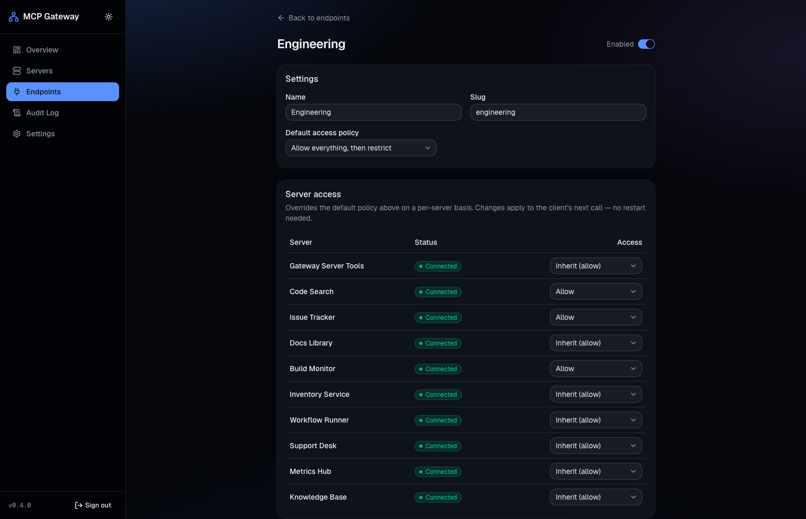
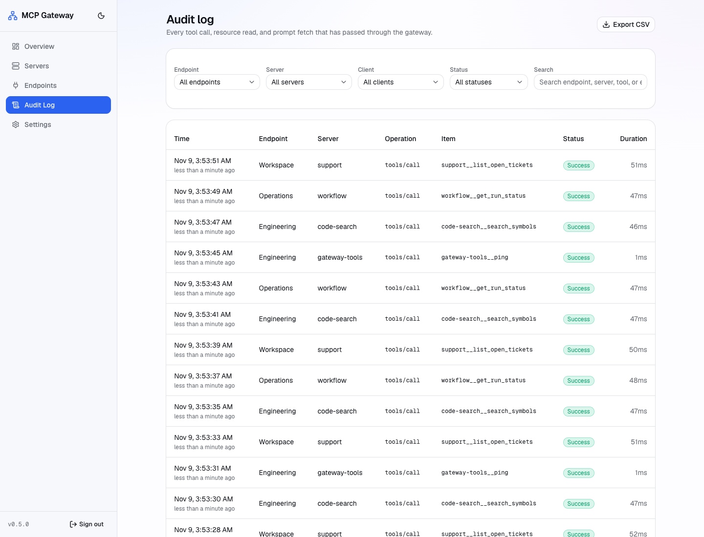

# MCP Gateway

A self-hosted dashboard for aggregating multiple [Model Context Protocol](https://modelcontextprotocol.io) (MCP) servers behind a single gateway — with per-client access control, a live network diagram, and a full audit trail.

Point Claude Desktop, Claude Code, or any other MCP client at one gateway URL instead of configuring each backend server individually. Namespaced tools (`server__tool`) from every connected backend show up as one unified toolset, with fine-grained control over which client can use which server.



## Features

### Backend servers

- **Any transport** — connect stdio (local command), Streamable HTTP, or SSE MCP servers from the dashboard, with live connection status and auto-reconnect for remote servers.
- **Guided add-server form, or paste an existing config** — already have a working MCP config for another client? Paste it and the guided form pre-fills for review instead of manually re-typing commands, env vars, or headers.
- **Edit in place** — change a server's command, arguments, environment variables, or headers after creation without deleting and re-adding it.
- **Per-tool kill switch** — disable individual tools on a server; a disabled tool disappears from every endpoint's tool list and is blocked from being called, regardless of that endpoint's access policy.
- **One-click and bulk reconnect** — reconnect a single server or every enabled server at once, without restarting the gateway process.
- **Built-in diagnostics** — Gateway Server Tools auto-seeds on first boot and provides `ping`, `gateway_status`, and `list_backend_servers`. Use the dashboard to register and manage backends.

### Client endpoints & access control

- **Unique URL + token per client** — create as many endpoints as you need; each gets its own bearer token, stored as a SHA-256 hash and shown in full exactly once.
- **Two default policies** — allow-everything-then-restrict, or deny-everything-then-grant, set per endpoint.
- **Per-server override rules** — a 3-state table (Allow / Deny / Inherit default) per backend server, evaluated fresh on *every* call rather than cached into a session's tool list — a rule change takes effect on the client's next call, no gateway restart needed.
- **Connected-client tracking** — endpoints identify distinct callers via an `X-MCP-Client-Id` header (or a random fallback if a client doesn't send one), so one endpoint shared across, say, both Claude Desktop and Claude Code shows each as a separate tracked client with its own last-seen time.
- **Ready-to-copy client config** — a config panel with `mcp.json` / Claude CLI / Tailscale tabs; the server entry name shown to clients is always the fixed `mcp-gateway`, so renaming an endpoint in the dashboard never breaks an already-configured client.

### Live visualization & audit

- **Real-time network diagram** — the homepage shows every backend server, the gateway, every client endpoint, and every connected client as a live topology graph, with animated pulses traveling along the edges as tool calls actually flow through — denied calls visibly stop at the gateway instead of continuing to the backend, and concurrent calls on the same edge are tracked independently.
- **Live activity feed** — a real-time, animated log of the most recent calls alongside the diagram, driven by the same Server-Sent Events stream.
- **Full audit log** — every tool call, resource read, and prompt fetch is recorded, including denials, with exact and relative timestamps, duration, and outcome. Filterable by endpoint, server, client, and status, with free-text search and CSV export.

### Security & deployment

- **Interactive backends** — elicitation and sampling are off on shared connections. An operator can opt in specific endpoint and backend pairs to run interactive calls on isolated connections.

- **No stored plaintext where it's avoidable** — endpoint tokens are hashed (SHA-256) at rest, never stored or retrievable in plaintext after creation.
- **CSRF-protected admin API** — mutating admin requests are checked against the app's own origin, closing off the class of attack where a malicious webpage tries to reach the locally-bound dashboard through a victim's browser.
- **Tailscale-aware** — detects an active tailnet connection and surfaces the real MagicDNS hostname/IP on the Settings page, with a dedicated config tab for Tailscale-based remote client access.
- **Installable Node CLI** — install via `npx`, `npm install -g`, or clone-and-run; ships as a self-contained CLI with no separate build step for consumers, automatic SQLite creation and migrations on first boot, and `.env`-based configuration.
- **CI-verified releases** — every push runs typecheck/lint/build; tagged releases automatically publish to npm (via OIDC Trusted Publishing — no stored npm token) and create a GitHub Release with auto-generated notes.

## Screenshots

<details>
<summary><strong>Backend servers</strong> — connection status, one-click reconnect, per-tool kill switch</summary>



Every backend server shows its live connection status and a **Reconnect all** action. Opening a server exposes its full tool list with an individual enable/disable switch per tool — a disabled tool disappears from every endpoint's tool list and is blocked from being called, regardless of that endpoint's access policy.



</details>

<details>
<summary><strong>Adding a server</strong> — guided form, or paste an existing config</summary>

Already have a working MCP config for another client? Paste it directly and the guided form gets pre-filled for review — no manual re-typing of commands, env vars, or headers.



</details>

<details>
<summary><strong>Client endpoints</strong> — per-server access rules, connected clients, ready-to-copy config</summary>



Each endpoint gets its own default policy (allow-all-then-restrict, or deny-all-then-grant) plus per-server overrides, a list of the distinct clients that have connected to it, and a client-config panel that's always ready to paste — the server entry name is always the fixed `mcp-gateway`, so renaming an endpoint never breaks an already-configured client.



</details>

<details>
<summary><strong>Audit log</strong> — every call, every denial, filterable and exportable</summary>



Every tool call is logged with exact and relative timestamps, duration, and outcome — including calls blocked by access policy, so a "why didn't this work" question always has an answer in the log instead of just in a client-side error.

</details>

## Quickstart

Run it directly, no clone needed — this builds and starts it from wherever you run the command:

```bash
npx @lloyd-aloysius/mcp-gateway
# or straight from GitHub, no npm needed:
npx github:lloyd-aloysius/mcp-gateway
```

Prefer a persistent install over `npx` re-fetching each time?

```bash
npm install -g @lloyd-aloysius/mcp-gateway
mcp-gateway
```

Or clone it if you want to poke at the source:

```bash
git clone <this-repo>
cd mcp-gateway
npm install
npm run dev
```

Either way, open [http://localhost:3000](http://localhost:3000). The SQLite database is created automatically in `./data/gateway.db` (relative to wherever you ran the command) on first run — no setup step required.

Add a backend server from the **Servers** page (e.g. `npx -y @modelcontextprotocol/server-everything` as a stdio server), then create a **client endpoint** and copy its config into your MCP client.

## Docker

A `Dockerfile` is included for running the gateway in a container instead of installing Node locally:

```bash
git clone <this-repo>
cd mcp-gateway
docker build -t mcp-gateway .
docker run -d --name mcp-gateway --env-file .env -p 127.0.0.1:3000:3000 -v mcp-gateway-data:/data mcp-gateway
```

Open [http://localhost:3000](http://localhost:3000). The `-v mcp-gateway-data:/data` volume is where the SQLite database lives — keep it (don't use `--rm`) so your servers, endpoints, and audit history survive container restarts and image updates.

The image is Alpine-based (musl libc) on purpose: `better-sqlite3`'s native binding ships separate prebuilds per platform, and its arm64 Linux build requires a newer glibc than its x64 build does — a gap that doesn't exist on musl, so this image works identically on x64 and arm64 hosts regardless of the host's own glibc version.

Override the port with `-e PORT=8080 -p 8080:8080`, or point at a custom database location with `-e DATABASE_PATH=/data/gateway.db` (already the default).

## Architecture

Everything runs in a single Next.js process:

- The dashboard UI and admin API (`/api/servers`, `/api/endpoints`, `/api/audit`, …) are ordinary Next.js pages and Route Handlers.
- The gateway itself is `/api/mcp/[slug]/route.ts` — one Route Handler per client endpoint, built on the MCP TypeScript SDK's `WebStandardStreamableHTTPServerTransport` (Fetch API-native, so no custom server is needed).
- Backend server connections (stdio child processes / remote HTTP or SSE clients) are held as in-process singletons, bootstrapped once at boot via `instrumentation.ts`.
- A `/api/events/stream` Server-Sent Events endpoint pushes real-time updates (connection status, tool calls, audit entries) to the dashboard — this is what drives the live diagram and activity feed.
- SQLite (via Drizzle ORM) stores backend server configs, client endpoints, access rules, and the audit log.

Because it holds live child processes and open SSE connections, this needs a **persistent, long-running process** — a VPS, a Docker container, or your own machine — not a serverless platform.

## Access control

Each client endpoint has a **default policy**:

- **Deny everything, then grant** — the endpoint sees no tools until you explicitly allow specific servers.
- **Allow everything, then restrict** — the endpoint sees every connected server's tools unless you explicitly deny one.

Per-server rules on the endpoint's settings page override the default for that server. Rule changes apply on the client's *next* call — no gateway restart required (though the client's own cached tool list may lag until it re-lists, which is normal MCP client behavior, not a gateway bug).

## Configuration

Copy `.env.example` to `.env` to override defaults:

| Variable | Default | Purpose |
|---|---|---|
| `DATABASE_PATH` | `./data/gateway.db` | Where the SQLite file lives |
| `PORT` | `3000` | Port `npm start` binds to |
| `HOST` | `127.0.0.1` | Host `npm start` binds to |

## Security notes

The CLI defaults to loopback. Remote and container administration requires a dedicated
`MCP_GATEWAY_ADMIN_TOKEN` of at least 24 characters and a trusted dashboard origin in
`MCP_GATEWAY_ADMIN_ORIGINS`. In a browser, use the username `admin` and the token as the
password. Admin scripts can use the token as a bearer credential. Keep the dashboard
behind TLS and restrict it to administrator devices. Give MCP clients a separate
hostname and forward only their MCP routes.

The admin API validates the request host and any supplied Origin against the configured dashboard origins. The reverse proxy should preserve the trusted Host and forward only the routes each hostname needs.

Client endpoint tokens are stored as SHA-256 hashes, never in plaintext — a token is shown once at creation (or after a regeneration) and cannot be retrieved again afterward.

Private or plain HTTP backend origins require an explicit
`MCP_GATEWAY_PRIVATE_BACKEND_ORIGINS` entry. Backend header and environment values
are write-only. Use references such as `${env:MCP_BACKEND_SECRET_EXAMPLE}` to keep
credentials outside SQLite. Audit capture defaults to operation metadata.

See the [deployment and recovery guide](docs/deployment/README.md) for a nonroot
Compose example, nginx configuration, backup, restore and rollback.

Found an actual security issue? Please see [SECURITY.md](SECURITY.md) for how to report it privately rather than opening a public issue.

## Tech stack

Next.js (App Router) · TypeScript · `@modelcontextprotocol/sdk` · Drizzle ORM + SQLite · Tailwind CSS + shadcn/ui · React Flow · Server-Sent Events

## Release verification

The release workflow tests the same npm tarball on Linux x64, Linux arm64 and
macOS arm64. It also builds and tests nonroot Linux container images and produces
component inventories for both distribution formats. Run `mcp-gateway --version`
or `mcp-gateway doctor` to check a local install.

## Contributing

Contributions are welcome — bug reports, feature ideas, and pull requests
alike. See [CONTRIBUTING.md](CONTRIBUTING.md) for dev setup, coding
conventions, and the PR checklist. Everyone participating is expected to
follow the [Code of Conduct](CODE_OF_CONDUCT.md).

## License

MIT — see [LICENSE](LICENSE).
